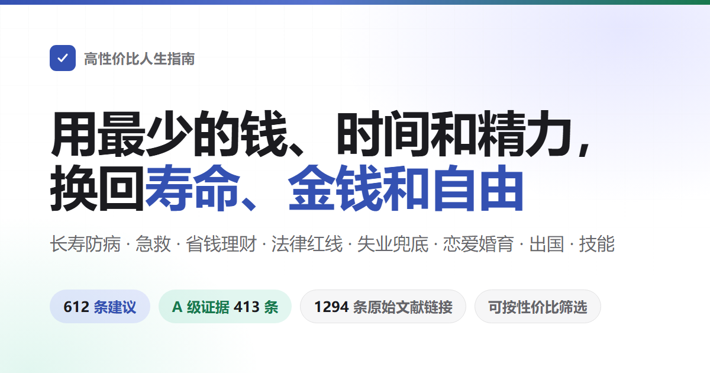
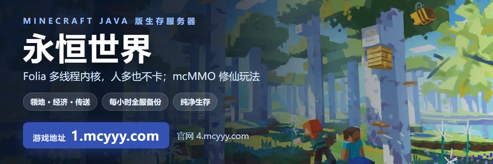

<div align="center">



# 가성비 인생 가이드

오래 사는 법, 덜 아픈 법, 사고가 났을 때 살리는 법을 다룬다. 억울한 돈을 덜 쓰는 법, 어떤 일이 사기나 소송으로 이어지는지를 다룬다. 일도 돈도 없을 때 무엇을 받을 수 있는지, 가게·회사·웹사이트를 열려면 어떤 절차를 밟아야 하는지를 다룬다. 연애, 결혼, 출산, 해외, 기술 배우기도 다룬다.<br>
612개 권고. 항목마다 무엇을 쓰고, 무엇을 얻고, 근거가 얼마나 단단한지 적었고, 출처는 학술지 논문과 공식 문서만 인용한다.

다 할 필요는 없다. 가성비 순으로 정리한 후보 목록이지 할 일 목록이 아니다. 한두 개 골라 가면 충분하고, 저자 자신도 대부분은 못 하고 있다.

[](https://devuterian.github.io/HowToLiveBetter-ko/)
[](#목차)
[](#근거-등급)
[](docs/核实记录/)
[](LICENSE)

**[온라인 검색 페이지 열기](https://devuterian.github.io/HowToLiveBetter-ko/)** · [PDF 내려받기(중국어 원문판)](https://github.com/eternity4719/HowToLiveBetter/releases/download/epub-latest/HowToLiveBetter.pdf) · [EPUB 내려받기(중국어 원문판)](https://github.com/eternity4719/HowToLiveBetter/releases/download/epub-latest/HowToLiveBetter.epub) · [오프라인 단일 파일(HTML) 내려받기(중국어 원문판)](https://github.com/eternity4719/HowToLiveBetter/releases/download/epub-latest/HowToLiveBetter.html) · [목차](#목차) · [용어집](#숫자-읽는-법용어집) · [확인 기록](docs/核实记录/) · [결혼은 남는 장사인가(장문)](docs/결혼은-남는-장사인가.md) · [가정용 비상장비 목록(장문)](docs/가정용-비상장비-목록.md) · [낯선 사람이 사고를 당했을 때 멈춰야 하나(장문)](docs/낯선-사람이-사고를-당했을-때-멈춰야-하나.md) · [플랫폼을 하려면 어떤 인허가가 필요한가(장문)](docs/플랫폼을-하려면-어떤-인허가가-필요한가.md) · [생체시계와 야간근무(장문)](docs/생체시계와-야간근무.md)

다른 언어: [English](https://dlgrv.github.io/HowToLiveBetter/en/) · [Русский](https://dlgrv.github.io/HowToLiveBetter/ru/) · [Español](https://dlgrv.github.io/HowToLiveBetter/es/) —— [dlgrv](https://github.com/dlgrv)가 관리하는 비공식 번역([저장소](https://github.com/dlgrv/HowToLiveBetter))이다. 번역은 번역 당시의 중국어 본문을 기준으로 했고, 그 뒤에 추가·수정된 항목은 따라가지 못했을 수 있다. 모든 내용은 원 저장소의 중국어 원문이 기준이다.

</div>

> 이 문서는 [중국어 원문](https://github.com/eternity4719/HowToLiveBetter)을 한국어로 옮긴 비공식 번역이다. 법령·기관·전화번호·제도는 모두 중국 기준이다. 본문 33장과 장문 문서 5편만 옮겼고, 확인 기록(docs/核实记录)과 인용 대조표는 원문 그대로 두었다.

---

## 이 책이 답하려는 질문

| 질문 | 어디를 볼까 |
| --- | --- |
| 돈을 거의 안 쓰고도 일찍 죽을 확률을 눈에 띄게 낮추는 일에는 뭐가 있나? | [1. 일찍 죽지 않기](book/01-일찍-죽지-않기.md) |
| 담배, 술, 오래 앉아 있기, 밤샘은 수명을 얼마나 깎나, 담배와 술은 구체적으로 어떻게 끊나? | [2. 서서히 죽어가지 않기](book/02-서서히-죽어가지-않기.md) |
| 날마다 에너지가 모자라고 자꾸 방해받는다면 어떻게 고치나? | [3. 에너지 낭비하지 않기](book/03-에너지-낭비하지-않기.md) |
| 시간은 다 어디로 갔나, 남는 것 없는 일을 어떻게 줄이나, 미루는 버릇은 어떻게 고치나? | [4. 시간 낭비하지 않기](book/04-시간-낭비하지-않기.md) |
| 모은 돈을 어디에 둬야 이자, 수수료, 사기에 먹히지 않나? | [5. 돈 낭비하지 않기](book/05-돈-낭비하지-않기.md) |
| 어떤 건강기능식품, 건강검진 패키지, 호갱 상품은 그냥 안 사도 되나? | [6. 하지 말 것 목록](book/06-하지-말-것-목록.md) |
| 실직했거나, 임금을 떼였거나, 수중에 돈이 없을 때 무엇을 받을 수 있고 어디에 도움을 청하나? | [7. 돈이 없을 때 살아남는 법](book/07-돈이-없을-때-살아남는-법.md) |
| 차이리(彩礼), 결혼 전 집, 연애 중 큰돈 송금은 누구 것인가, 누가 신고해서 고발당하거나 사실을 꾸며 제보당했을 때 첫걸음은 무엇인가, 내가 일을 저질렀을 때 스스로 털어놓으면 형이 얼마나 줄어드나, 나중에 책임을 묻고 배상을 받을 수 있나? | [8. 법과 재산 지키기](book/08-법과-재산-지키기.md) |
| 어떤 "아르바이트"와 대수롭지 않은 일이 평범한 사람을 형사 피고인으로 만드나? | [9. 평범한 사람이 넘기 쉬운 법의 선](book/09-평범한-사람이-넘기-쉬운-법의-선.md) |
| 이성을 만날 때 여러 사람에게 기회를 넓힐까 한 사람에게 매달릴까, 장거리 연애는 될까, 혼인신고에는 뭘 챙겨 가나? | [10. 연애와 결혼은 남는 장사인가](book/10-연애와-결혼은-남는-장사인가.md) |
| 어떤 코드를 짜고 어떤 일감을 받으면 형을 받나? | [11. 개발자와 기술자가 넘기 쉬운 선](book/11-개발자와-기술자가-넘기-쉬운-선.md) |
| 돈을 빌려 가게나 회사를 차리기 전에 가장 먼저 따져 봐야 할 건 무엇인가? | [12. 창업과 장사](book/12-창업과-장사.md) |
| 누가 쓰러져 숨을 안 쉬거나, 피를 많이 흘리거나, 불이 나거나, 길을 잃었을 때 무엇부터 하나? | [13. 응급상황: 무엇부터 할까](book/13-응급상황.md) |
| 계정을 도용당했거나 휴대폰을 잃어버렸을 때 첫걸음은? | [14. 계정과 정보 보안](book/14-계정과-정보-보안.md) |
| 보증금을 떼이고, 집주인이 내쫓고, 장기임대 아파트 업체가 무너지면 어떻게 하나? | [15. 전월세와 집 사기](book/15-전월세와-집-사기.md) |
| 만성질환 진단을 받은 뒤 오래 어떻게 관리하고 어떻게 돈을 덜 쓰나? | [16. 만성질환과 함께 사는 법](book/16-만성질환과-함께-사는-법.md) |
| 어르신의 후견, 유언, 돈은 미리 어떻게 정리해 두나? | [17. 집에 어르신이 있을 때](book/17-집에-어르신이-있을-때.md) |
| 아이를 낳으면 무엇을 받을 수 있고, 시간과 돈은 얼마나 드나? | [18. 아이 키우기는 남는 장사인가](book/18-아이-키우기는-남는-장사인가.md) |
| 초과근무 수당과 연차휴가는 어떻게 계산하나, 해고되면 보상은 얼마나 받나, 일하다 다치면 어떻게 인정받고 돈을 받나? | [19. 재직, 퇴직, 산재](book/19-재직-퇴직-산재.md) |
| 아이가 막 태어났을 때 가장 중요한 몇 가지는 무엇인가? | [20. 갓난아기 돌보기](book/20-갓난아기-돌보기.md) |
| 지금 가면 안 되는 나라는 어디인가, 일이 생기면 대사관·영사관은 어디까지 도와주나? | [21. 해외여행과 해외 안전](book/21-해외여행과-해외-안전.md) |
| 노래방, PC방, 방탈출에서 어떻게 봉변을 피하나, 스트레스가 클 때 무엇이 가장 도움이 되나? | [22. 쉬는 법: 유흥업소와 스트레스 풀기](book/22-쉬는-법.md) |
| 용접, 영어, 자격증 중 무엇이 정말 본전을 뽑나, 어떻게 배워야 시간을 아끼나, 직함(职称)은 어디서 신청하고 받을 만한가? | [23. 어떤 기술을 배워야 남는가](book/23-어떤-기술을-배워야-남는가.md) |
| 같은 병을 동네 의원에서 보는 것과 3급 병원에서 보는 것은 돈이 얼마나 차이 나나, 크게 다쳤을 때 접수 줄을 설까 응급실 분류 창구로 갈까, 치료가 끝나면 장애 판정을 받고 장애인증을 만들어야 하나? | [24. 병원 다니기: 돈 덜 쓰고 헛걸음 덜 하는 법](book/24-병원-다니기.md) |
| 가족이 세상을 떠났을 때 그 자리에서 무엇부터 하고, 어떤 돈은 돌려받을 수 있고, 어떤 비용은 안 내도 되나? | [25. 가족이 세상을 떠난 뒤 할 일](book/25-가족이-세상을-떠난-뒤-할-일.md) |
| 웹사이트나 플랫폼을 만들어 돈을 받으려면 어떤 인허가를 받아야 하고, 서버는 어디에 두나? | [26. 웹사이트나 플랫폼 만들기](book/26-웹사이트나-플랫폼-만들기.md) |
| 임신했을 때, 곧 낳을 때 언제 무엇을 하고, 퇴원 전에 어떤 서류를 떼야 하나? | [27. 임신과 출산](book/27-임신과-출산.md) |
| 살을 빼고 싶고 예뻐지고 싶을 때 어떤 방법이 몸을 망치나? | [28. 외모 때문에 몸 망치지 않기](book/28-외모-때문에-몸-망치지-않기.md) |
| 가족을 잃었거나, 해고됐거나, 중병 진단을 받았을 때 처음 몇 달 동안 가장 중요한 건 무엇인가? | [29. 큰 타격을 입은 뒤](book/29-큰-타격을-입은-뒤.md) |
| 아이가 학교에 다니기 시작한 뒤, 몸과 마음의 어떤 일은 시험이 끝날 때까지 미루면 안 되나? | [30. 학교에 다니는 아이](book/30-학교에-다니는-아이.md) |
| 열여덟 살 이후 공부와 일 말고 어떤 길이 있고, 각각의 문턱은 무엇인가? | [31. 열여덟 살 이후의 길](book/31-열여덟-살-이후의-길.md) |
| 해외 유학 중 비자 신분이 끊기지 않으려면 어떻게 해야 하나, 귀국하면 그 학위를 인정받나? | [32. 해외 유학: 체류 신분, 아르바이트, 보험, 귀국 후 학력 인증](book/32-해외-유학.md) |
| 나나 가족에게 장애가 생겼을 때 어떤 합병증부터 막고, 어떤 보조금을 신청하고, 학업·취업·후견은 어떻게 하나? | [33. 장애가 생긴 뒤 사는 법](book/33-장애가-생긴-뒤-사는-법.md) |

## 읽는 법

- **다 할 필요는 없다**: 가성비 순으로 정리한 후보 목록이지 할 일 목록이 아니다. 한두 개 골라 가면 충분하고, 나머지는 두었다가 필요할 때 다시 와서 찾으면 된다. "말은 쉬워도 하기는 어렵다"는 평은 맞다. 저자 자신도 대부분은 못 하고 있고, 필요할 때 찾을 수 있도록 적어 둔 것이다. 힘 덜 드는 것부터 고르고 싶으면 아래 "가장 할 만한 것만 보고 싶다면" 항목을 보라.
- **조건으로 고르고 싶다면**: [온라인 검색 페이지](https://devuterian.github.io/HowToLiveBetter-ko/)를 열면 키워드, 장, 근거 등급으로 거를 수 있다. "돈이 드나, 시간이 얼마나 드나, 의지력이 필요한가" 세 가지로도 거를 수 있고, 여러 조건을 겹쳐 쓸 수 있다. 페이지 내용은 book/ 디렉터리의 본문에서 바로 가져오므로, 본문이 바뀌면 페이지도 따라 바뀐다.
- **항목끼리 서로 길을 가리킨다**("제8장 17번을 보라" 같은 것): 검색 페이지에서는 이런 안내에 점선이 붙는다. 한 번 누르면 가리키는 항목의 제목과 "쉽게 말하면"이 그 자리에 뜬다. 정말 넘어가고 싶으면 "건너가기"를 누른다. 그 항목이 마침 필터 조건에 가려져 있으면 페이지가 알아서 필터를 지운다. GitHub에서 본문을 바로 읽을 때는 누를 수 없지만, 안내마다 뒤에 무엇을 가리키는지 적혀 있다("18번(돈을 빌려줄 때 차용증을 분명히 쓴다)을 보라"). 넘어가지 않아도 어느 항목 얘기인지 안다.
- **순서대로 읽고 싶다면**: 각 장 안의 항목은 가성비가 높은 것부터 낮은 것 순이다. 장마다 앞의 몇 항목부터 보면 된다.
- **AI에게 찾아 달라고 하고 싶다면**: 저장소에 중국어 skill이 하나 들어 있다(이 번역본에서는 한국어로 옮겼다)([skills/life-decision-guide](skills/life-decision-guide/)). Claude Code와 Codex 모두에 설치할 수 있다. 설치한 뒤 "친구 보증을 서 줄까 말까", "매일 출퇴근에 두 시간 쓰는 게 할 만한가" 하고 바로 물으면 된다. 관련 항목을 본문에서 먼저 찾아낸 뒤, 책의 계산 방식대로 순서를 매겨 답하고, 제몇 장 몇 번에서 나왔는지 밝힌다. 못 찾으면 못 찾았다고 하고, 숫자를 지어내지 않는다. 설치 방법은 [그 디렉터리의 설명](skills/life-decision-guide/README.md)에 있다.
- **오프라인으로 보거나 남에게 보내고 싶다면**: [오프라인 단일 파일 HTML](https://github.com/eternity4719/HowToLiveBetter/releases/download/epub-latest/HowToLiveBetter.html)(중국어 원문판)을 내려받는다. 책 전체와 검색·필터가 이 파일 하나에 다 들어 있다. 두 번 클릭하면 열리고, 서버도 인터넷도 필요 없으며, 위챗으로도 바로 보낼 수 있다.
- **인쇄하거나 휴대폰으로 넘겨 보고 싶다면**: [PDF](https://github.com/eternity4719/HowToLiveBetter/releases/download/epub-latest/HowToLiveBetter.pdf)(중국어 원문판)를 내려받는다. A4 판형에 200쪽이 넘고, 쪽 번호가 붙은 목차와 책갈피가 있으며, 장마다 새 쪽에서 시작한다.
- **Kindle이나 다른 리더기로 읽고 싶다면**: [EPUB 전자책](https://github.com/eternity4719/HowToLiveBetter/releases/download/epub-latest/HowToLiveBetter.epub)(중국어 원문판)을 내려받는다. Kindle은 Send to Kindle로 보내면 된다.
- **세 가지 모두 본문이 바뀔 때마다 자동으로 다시 만들어진다.** 내려받기 링크는 고정이다. 남에게 보낸 사본은 따라서 갱신되지 않으니 온라인판을 기준으로 한다.
- **그 숫자들이 무슨 뜻인지 모르겠다면**: 항목마다 "쉽게 말하면" 한 줄이 있다. "효과" 칸에 있는 연구식 표현을 "같은 기간에 죽을 확률이 약 20% 낮다", "구류 며칠, 벌금 얼마" 같은 일상어로 옮긴 것이다. "효과" 칸에 이미 있는 내용만 쓰고 새 숫자는 보태지 않는다. 이 한 줄만 봐도 결정하기에 충분하다. "효과" 칸에는 모든 숫자가 원래대로 남아 있으니, 직접 확인하고 싶으면 그 칸을 보라.
- **결론이 가장 단단한 것만 보고 싶다면**: 검색 페이지에서 근거 등급 A를 고르면 구체적인 숫자가 있고 메타분석이나 대규모 시험에서 나온 413개만 남는다.
- **가장 할 만한 것만 보고 싶다면**: 가성비 "매우 높음"을 고르면, 돈도 시간도 의지력도 들지 않으면서 효과는 가장 큰 단계에 드는 104개가 나온다. 여기에 "무엇을 얻나"를 하나 더 겹치면 그 기준의 우선순위 목록이 된다.
- **"~하지 않기"로 시작하는 장 제목에 긴장할 필요 없다**: 장 제목은 그 장이 막으려는 일을 말한다(일찍 죽지 않기, 시간 낭비하지 않기). 그 아래 항목이 전부 무엇을 하지 말라는 뜻은 아니다. 실제로 할 동작은 항목 제목에 있고, 모두 동사로 시작하며, "무엇을 하라"인지 "무엇을 하지 마라"인지 제목이 스스로 밝힌다. 한 장 안에 두 종류가 다 있다. 제4장에는 "'하려고 한다'를 '몇 시에, 어디서, 무슨 일이 생기면 무엇을 한다'로 바꿔 적는다"도 있고, "TV와 끝없이 이어지는 뉴스를 보지 않는다"도 있다. 항목 제목대로 읽으면 되고, 장 제목의 말투에 끼워 맞출 필요는 없다.

권고 하나는 이렇게 생겼다.

```markdown
### 5. 집에서 쓰는 소금을 저나트륨 소금(칼륨 소금)으로 바꾼다
- 비용: 한 봉지에 보통 소금보다 몇 위안 비싸다. 살 때 바꾸면 되니 따로 시간이 들지 않는다. 맛은 거의 그대로다.
- 쉽게 말하면: 2만 명을 대상으로 한 무작위 시험에서, 집의 소금을 저나트륨 소금으로 바꾼 사람은 5년 안에 죽을 확률이 약 12%, 뇌졸중이 약 14% 낮았다. 무작위로 두 그룹을 나눠 비교한 결과라서, 따라가며 기록만 한 숫자보다 더 믿을 만하다.
- 효과: 사람들을 무작위로 두 그룹으로 나눈 시험으로, 중국 농촌에서 했다. 20995명, 모두 뇌졸중을 앓은 적이 있거나 60세 이상 고혈압 환자이고, 4.74년 동안 추적했다. 결과: 저나트륨 소금을 쓴 그룹은 보통 소금을 쓴 그룹보다 사망 위험이 약 12% 낮았다(RR 0.88). 뇌졸중은 약 14% 낮았다(RR 0.86). 주요 심혈관 사건은 약 13% 낮았다(RR 0.87).
- 근거 등급: A
- 출처: Neal B 등 (2021). Effect of Salt Substitution on Cardiovascular Events and Death. NEJM. https://doi.org/10.1056/NEJMoa2105675
- 비고: 논쟁. 시험 대상은 위험이 높은 노인이었고, 건강한 젊은 사람이 소금을 바꿔서 얻는 이득은 훨씬 작다. 신장 기능이 떨어진 사람이나 칼륨 보존 계열 약을 먹고 있는 사람은 소금을 바꾸기 전에 먼저 의사에게 물어보라.
```

## 직접 돌려 보기

대부분은 배포할 필요가 없다. [온라인 검색 페이지](https://devuterian.github.io/HowToLiveBetter-ko/)가 이미 있고, 오프라인이 필요하면 [오프라인 단일 파일 HTML](https://github.com/eternity4719/HowToLiveBetter/releases/download/epub-latest/HowToLiveBetter.html)(중국어 원문판)을 내려받아 두 번 클릭하면 열린다.

정말 내 컴퓨터나 서버에서 돌리려면:

```bash
git clone https://github.com/devuterian/HowToLiveBetter-ko.git
cd HowToLiveBetter-ko
python -m http.server 8000
```

그다음 브라우저로 `http://localhost:8000/`을 연다. 검색 페이지는 순수 정적 페이지다. `README.md`와 `book/`이 곧 데이터이고, 백엔드도 데이터베이스도 없으며 의존성을 설치할 필요도 없다. 디렉터리 전체를 어느 정적 서버(Nginx, GitHub Pages, 오브젝트 스토리지)에 올려도 똑같이 동작한다. 단, `index.html`은 반드시 http로 열어야 한다. 로컬 파일을 그냥 두 번 클릭하면 빈 화면이 나온다. 브라우저가 웹페이지에 로컬 파일을 읽지 못하게 하기 때문이다. 그런 경우에는 위의 오프라인 단일 파일판을 쓰라.

전자판 세 가지를 직접 만들고 싶다면(평소에는 필요 없다. Release에 있는 게 자동으로 만들어진 것이다):

```bash
cd tools/epub && npm ci && npm run build   # EPUB
node tools/offline/build.mjs               # 오프라인 단일 파일 HTML
node tools/pdf/build.mjs                   # PDF, pandoc ≥ 3.1과 typst ≥ 0.13이 따로 필요
```

결과물은 모두 `dist/`에 생긴다.

## 네 가지 자원

이 책이 더 많이 지켜 주려는 건 수명만이 아니다. 모두 네 가지다.

- **수명**: 더 오래 살고, 원래 피할 수 있었던 일로 덜 죽는다
- **시간과 에너지**: 살아 있는 시간을 보답 없는 일에 쓰지 않고, 날마다의 주의력과 체력을 헛되이 덜 소모한다
- **돈**: 억울한 돈을 덜 쓰고, 효과가 확실한 곳에 돈을 쓴다
- **신체의 자유**: 법의 선 하나를 몰라서 구류소나 구치소에 들어가는 일이 없게 한다

권고마다 두 가지 질문에 답한다. 무엇을 쓰는가(돈/시간/에너지/의지력), 무엇을 얻는가(총사망률 변화 / 특정 사인 감소 / 시간과 에너지 절약 / 돈 절약 / 보장과 신체의 자유). 항목은 분류가 아니라 가성비 순으로 정렬한다. 비용이 거의 들지 않으면서 얻는 이득이 큰 것을 맨 앞에 둔다.

**권고 하나의 이득이 누구에게 돌아가는지는 단계로 나뉜다.** "이 이득이 나중에 나 자신에게 돌아올 가능성이 얼마나 되나"를 기준으로 높은 것부터 ① **나 자신**, ② **배우자와 직계가족**(부모, 자녀, 친가·외가 조부모, 친손주·외손주), ③ **친구, 동료, 그 밖의 친척**: 서로 주고받는 관계라 도와준 것이 나중에 돌아올 수 있다, ④ **낯선 사람**: 가장 낮은 단계지만 0은 아니다. 보답받을 확률이 작고, 상대의 성격을 모르며, 덤터기를 쓰거나, 도리어 물리거나, 보복당하는 면도 있다. 서로 다른 단계는 합쳐서 계산하지 않고, ④단계를 쓸 때는 이득과 위험을 함께 쓴다.

응급처치 장은 이렇게 읽으면 된다. 중국의 병원 밖 심정지 38,227건 가운데 79.2%가 집에서 일어났다. 가슴 압박을 배우는 건 무엇보다 우리 집 사람에게 하기 위해서다. "누가 물에 빠진 걸 봐도 직접 뛰어들지 않는다", "싸움을 마주쳐도 손으로 뜯어말리지 않는다" 같은 규칙은 그 자체로 나를 지키는 규칙이다. 구경꾼이던 내가 두 번째 부상자가 되는 걸 막는다. 낯선 사람에게 손을 쓸지는 내가 저울질할 일이다. 항목은 면책 조항, 나를 지키는 동작, 위험한 면을 모두 분명히 적고, 그걸 반드시 해야 할 이유로 대신 계산해 주지 않는다.

사망률 숫자, 시간과 에너지 숫자, 돈 숫자, 법적 결과는 각자 따로 계산하고 서로 환산하지 않는다. 이 네 가지는 검색 페이지의 "무엇을 얻나" 네 가지에 대응하며, 서로 크기를 비교하지 않는다.

## 근거 등급

권고마다 근거 등급을 표시한다.

| 등급 | 뜻 |
| --- | --- |
| A | 확인할 수 있는 구체적 숫자가 있다. 출처는 여러 연구를 합친 메타분석, 많은 사람을 여러 해 추적한 대규모 코호트 연구, 또는 무작위로 그룹을 나눈 시험(RCT)이고, 얼마나 줄었는지(HR, RR, 감소 비율) 말할 수 있다 |
| B | 연구의 뒷받침은 있지만 정확한 숫자를 말할 수 없다. 또는 소규모 표본이나 단일 연구 하나만 받치고 있다 |
| C | 저자 자신의 경험이나 모두가 인정하는 방식이고, 직접적인 연구 문헌은 없다 |

책 전체 612개 가운데 A등급 413개, B등급 150개, C등급 49개다. 그 밖에 56개에 논쟁 표시가, 35곳에 TODO 확인 필요 표시가 붙어 있다. 논쟁이 있는 A/B등급 항목에는 "논쟁"을 표시하고 반대쪽 근거를 적는다. 모든 출처는 원문 문헌만 인용하고(학술지 논문은 DOI나 PubMed 링크를 붙이며, 또는 WHO/CDC/국가통계국 같은 공식 기관 보고서), 2차 전달은 인용하지 않는다. 확실하지 않은 숫자에는 "확인 필요"를 붙인다.

## 가성비 등급

근거 등급은 "이 숫자를 믿을 수 있나"에만 답하고, "이 일을 할 만한가"에는 답하지 않는다. 그래서 항목마다 두 가지를 따로 더 표시했다. 효과 크기(이득이 얼마나 큰가)와 기준(얻는 게 어떤 종류인가)이다. 검색 페이지는 이 둘에 비용 세 가지를 더해 가성비 등급을 만든다.

| 차원 | 값 | 정하는 법 |
| --- | --- | --- |
| 기준 | 수명 / 돈 / 시간과 에너지 / 신체의 자유 | 이 항목이 주로 무엇을 얻게 해 주는지 본다. **기준이 다른 것끼리는 비교하지 않는다.** "총사망률 12% 감소"와 "해마다 500위안 절약"은 같은 자로 잴 수 없어서 우열을 가릴 수 없다 |
| 효과 크기 | 큼 / 중간 / 작음 | 되도록 항목 자신의 "효과" 칸을 보고 미리 정한 경계에 맞춰 넣고, 감으로 정하지 않는다. 수명은 몇 % 줄었는지 본다(≥20%는 큼, 10–20%는 중간, <10%이거나 중간 지표만 쟀고 최종 결과는 재지 않았으면 작음). 돈은 금액을 본다(만 위안 단위는 큼, 수백~수천은 중간, 수십 위안은 작음). 신체의 자유는 결과를 본다(형사책임을 피하면 큼, 구류나 행정처벌을 피하면 중간, 민사 분쟁을 피하면 작음). 시간과 에너지는 얼마나 아끼는지 본다(날마다 시간 단위로 아끼면 큼, 주마다 시간 단위면 중간, 한 번만 아끼면 작음) |
| 가성비 | 매우 높음 / 높음 / 보통 | 이득이 크고 비용 세 가지가 모두 0 = 매우 높음. 이득이 크고 비용이 높지 않거나, 이득이 중간이고 비용이 0 = 높음. 나머지 = 보통 |

책 전체 612개 가운데 가성비 매우 높음 104개(17%), 높음 277개(45%), 보통 231개(38%)다. 가운데 등급이 많은 건 의도한 것이다. 그 밑의 효과 크기가 원래 큼·중간·작음 세 단계뿐인데, 더 잘게 쪼개면 꾸며 낸 정밀함이 된다.

**이 등급은 저자 자신의 판단이지 근거가 아니다.** 이 책의 기준으로는 그 자체가 C등급밖에 안 된다. 근거 등급과는 별개이고 서로 영향을 주지 않는다. 근거는 A등급인데 가성비는 보통인 항목도 있고(대상포진 백신은 효력 97.2%의 3상 RCT가 있지만, 두 번 맞는 데 3000~4000위안이 들고 대상포진으로 죽는 일은 드물다), 근거는 C등급뿐인데 가성비는 매우 높은 항목도 있다(출국 전에 일정을 가족에게 보내 두기). "보통"이 하지 말라는 뜻은 아니다. 책의 항목은 모두 하라고 권하는 것이고, 다만 이 등급은 그 비용이 값어치를 하는지 스스로 따져 봐야 한다는 뜻이다.

## 숫자 읽는 법(용어집)

본문은 되도록 일상어를 쓰지만, 연구를 인용하다 보면 통계 용어 몇 개가 나올 수밖에 없다. 모르겠으면 이 표를 찾아보라. 온라인 검색 페이지에서는 점선이 붙은 낱말 위에 마우스를 올리면(휴대폰에서는 한 번 누르면) 설명이 뜬다.

<details>
<summary>용어 41개 펼치기(총사망률, HR, RR, 95% CI, 메타분석, BMI, LPR, 定金(계약 보증금)과 订金(선금)……)</summary>

| 용어 | 뜻 |
| --- | --- |
| 총사망률 | 일정 기간 동안 한 집단에서 죽은 사람의 비율. 무슨 이유로 죽었는지는 따지지 않는다. 이 책은 "얼마나 오래 사나"를 이걸로 잰다. 연구 원문에서는 전체 원인 사망률이라고 하고, 영어 약자는 ACM이다 |
| HR | 위험비. 같은 기간 동안 어떤 일을 한 그룹에서 사건(사망, 발병)이 일어나는 속도를, 하지 않은 그룹의 속도로 나눈 것. HR 0.87이면 하지 않은 그룹보다 13% 낮고, HR 1.21이면 21% 높다 |
| RR | 상대위험. 두 그룹에서 사건이 일어날 가능성의 비. 읽는 법은 HR과 같다 |
| OR | 오즈비. 역시 두 그룹을 비교하는데, 계산법이 RR과 조금 다르다. 비교하는 일이 드물면 RR과 거의 같다. 그 일이 흔하면 차이를 실제보다 크게 말한다 |
| IRR | 발생률비. 발생률은 일정 기간 동안 그 병에 새로 걸린 사람의 비율이고, 두 그룹을 나눈 것이다. 읽는 법은 RR과 같다 |
| RaR | 발생 횟수비. 몇 명이 사건을 겪었느냐가 아니라 사건이 몇 번 일어났느냐(예: 몇 번 넘어졌나)를 비교한다. 읽는 법은 RR과 같다 |
| 표준화 사망비 | 영어 약자 SMR. 이 집단에서 실제로 죽은 사람 수를 "같은 나이의 보통 사람이라면 죽었을 사람 수"로 나눈 것. 5.86이면 죽은 사람 수가 같은 나이대의 5.86배다 |
| 위험차 | 두 그룹의 사건 확률을 뺀 것. "1000명당 몇 명이 더 생기나"가 바로 나온다. 배수는 몇 배가 됐는지만 말하고, 위험차는 실제로 몇 명이 늘었는지 말한다 |
| 95% CI | 95% 신뢰구간. 연구로 계산한 숫자에는 늘 오차가 있고, 이건 실제 값이 들어 있을 가능성이 높은 범위다. 배수로 된 숫자는 범위가 1을 넘나들고, 덧셈·뺄셈으로 된 숫자는 범위가 0을 넘나들면, 두 그룹의 차이가 우연일 수도 있다는 뜻이다. 본문에는 "통계적으로 유의하지 않다"고 적는다 |
| RCT | 무작위 대조시험. 제비뽑기 같은 방법으로 사람들을 두 그룹으로 나눠, 한 그룹은 그 일을 하고 한 그룹은 하지 않게 한 뒤 결과가 얼마나 다른지 비교한다. "바로 이 일이 효과를 냈다"를 증명하는 데 가장 설득력 있는 방법이다 |
| 메타분석 | 여러 연구의 결과를 한데 모아 다시 계산해 전체 숫자 하나를 얻는 것. meta 분석이라고도 한다 |
| 코호트 | 코호트 연구. 많은 사람을 골라 여러 해 추적하며 누구에게 무슨 일이 생겼는지 기록한다. 두 일이 자주 함께 나타난다는 건 보여 줄 수 있지만, 앞의 일이 뒤의 일을 일으켰다고 증명하기에는 모자라다 |
| 관찰 연구 | 연구자가 옆에서 기록만 하고, 누가 하고 누가 안 할지 정하지 않는 연구. 결과가 다른 요인에 쉽게 치우치므로(이 표의 교란, 역인과 두 항목 참고) 숫자를 좀 깎아서 봐야 한다 |
| 교란 | 제3의 요인이 원인과 결과를 동시에 움직여서, 두 일이 인과관계처럼 보이게 만드는 것. 예를 들어 채소를 즐겨 먹는 사람은 운동도 더 즐기는 경우가 많아서, 어느 쪽이 효과를 냈는지 가려내기 어렵다 |
| 역인과 | 인과의 방향을 거꾸로 본 것. 앞의 일이 뒤의 일을 일으킨 것처럼 보이지만, 실은 뒤의 일이 앞의 일을 일으켰다. 오래 자서 일찍 죽는 게 아니라, 병이 깊은 사람이 오래 자는 것이다 |
| d, g | 효과크기. 두 그룹의 차이가 얼마나 큰지 나타낸다. 차이를 "흔한 변동 폭의 몇 배인가"로 바꿔 말한다. 0.2는 작음, 0.5는 중간, 0.8은 큼 |
| r | 상관계수. 두 일이 함께 변하는 정도. 값은 -1에서 1까지이고, 0.1은 약함, 0.3은 중간, 0.5는 강함 |
| MET | 운동 강도의 단위. 가만히 앉아 있으면 1 MET, 빨리 걷기는 3~4 MET쯤이다. MET·h로 쓰면 강도에 몇 시간 했는지를 곱한 것으로, 모두 얼마나 움직였는지를 나타낸다 |
| GRADE | 국제적으로 널리 쓰는 평가 방법. 근거가 얼마나 믿을 만한지 높음, 중간, 낮음, 매우 낮음 네 단계로 매긴다 |
| 선별검사 의향 분석 | 효과를 계산할 때 "누가 실제로 검사를 받았나"가 아니라 "누구에게 검사받으라고 알렸나"로 계산하는 것. 알림을 받은 사람 중에는 안 간 사람도 있어서, 이 방식은 실제로 검사받은 사람이 얻는 이득을 낮게 잡는다 |
| 갑년 | 한 사람이 담배를 모두 얼마나 피웠는지 세는 단위. 하루 몇 갑에 몇 년 피웠는지를 곱한다. 30갑년이면 하루 한 갑을 30년 피운 것이다 |
| BMI | 체질량지수. 비만도를 볼 때 흔히 쓰는 수. 체중(kg)을 키(m)의 제곱으로 나눈다 |
| LDL | 저밀도 지단백 콜레스테롤. 흔히 나쁜 콜레스테롤이라고 한다 |
| eGFR | 추정 사구체여과율. 콩팥의 거르는 능력을 재는 지표이고, 단위는 mL/min/1.73 m²다. 수가 낮을수록 콩팥 기능이 나쁘다는 뜻이고, 만성 콩팥병의 병기도 이걸로 정한다 |
| HBsAg | B형 간염 표면항원. 검사지에 나오는 항목 하나다. 양성이면 이미 B형 간염 바이러스에 감염됐다는 뜻이다 |
| HPV | 인유두종바이러스. 여러 형이 있고, 그중 일부 형은 오래 감염되면 자궁경부암을 일으킨다 |
| LDCT | 저선량 흉부 CT. 방사선량이 보통 CT의 5분의 1~10분의 1쯤이다 |
| PM2.5 | 공기 중에 떠다니는 미세먼지 가운데 지름 2.5마이크로미터 이하인 것 |
| NOVA | 식품을 분류하는 방법 하나. 가공 정도에 따라 네 종류로 나누고, "초가공식품"이 그 네 번째 종류다 |
| LPR | 대출우대금리. 중국 대출 금리의 기준이고 매월 20일에 한 번 발표된다. 주택담보대출 금리와 민간 대출 이자 상한이 모두 이걸 따라 계산된다 |
| 일재종국(一裁终局) | 노동중재 결과가 나오면 바로 효력이 생기고, 회사는 같은 일로 다시 법원에 소송을 낼 수 없는 것 |
| 조혼인율, 조이혼율 | 1000명당 그해 혼인신고, 이혼 등록을 한 쌍 수. 이혼 대 혼인 비율이라는 수도 따로 있는데, 그해 이혼 쌍 수를 혼인 쌍 수로 나눈 것으로 이 둘과는 다르다. 섞어서 보지 마라 |
| AED | 자동 제세동기. 공공장소에서 흔히 보는 빨간색이나 노란색 응급 상자다. 켜고 나서 음성 안내를 따라 하면 되고, 전기 충격이 필요한지는 기계가 스스로 판단한다 |
| CPR | 심폐소생술. 심정지 때 가슴을 세게 눌러 피가 계속 돌게 하는 것 |
| 3C 인증 | 중국 강제성 제품 인증. 목록에 오른 제품은 이 마크가 없으면 출고도 판매도 할 수 없다 |
| ICP 비안(备案) | 웹사이트나 앱을 정식으로 열기 전에 공업정보화부 시스템에 등록하는 절차 |
| 등급 보호 | 네트워크 안전 등급 보호 제도. 시스템이 얼마나 중요한지에 따라 몇 등급으로 나누고, 등급이 높을수록 갖춰야 할 보안 조치가 많다 |
| GPL | 오픈소스 라이선스의 하나. 이런 코드를 써서 만든 것을 배포할 때는 보통 내 코드도 함께 공개해야 한다 |
| 경업 제한 | 회사와 맺는 약정의 하나. 퇴사 후 일정 기간 동종 업계 경쟁사에 가서 일하지 않는다. 그 기간 동안 회사는 매달 보상을 줘야 하고, 최장 2년이다 |
| 인수 출자 | 회사를 등록할 때 넣겠다고 약속한 돈. 약속했으면 법이 정한 기한 안에 실제로 내야 한다. 보기 좋으라고 숫자만 적는 게 아니다 |
| 定金(계약 보증금)과 订金(선금) | 두 낱말은 한 글자만 다르지만 효력은 크게 다르다. 定金에는 제재가 있다. 돈을 받은 쪽이 마음을 바꾸면 두 배로 돌려줘야 하고, 금액은 계약금액의 20%까지다. 订金은 미리 낸 돈일 뿐이라, 마음을 바꿔도 이런 제재가 없다 |

</details>

## 목차

1. [일찍 죽지 않기](book/01-일찍-죽지-않기.md): 외부 원인 사망, 가스와 중독, 백신, 선별검사, 심리 위기와 자살 생각의 시간 척도, 살아난 뒤에 남는 것, 추락으로 크게 다친 뒤의 그 한 해, 콩팥 하나를 판 뒤 남은 콩팥의 장부, 가정용 비상장비, 눈에 보이는 혈뇨처럼 검사받으러 가야 할 신호. 기준: 총사망률 또는 특정 사인.
2. [서서히 죽어가지 않기](book/02-서서히-죽어가지-않기.md): 담배와 술, 운동, 수면, 식사, 오래 앉아 있기, 그리고 담배와 술을 끊는 구체적인 방법(금연약, 금연일, 금연 클리닉과 핫라인, 전자담배, 알코올 금단은 혼자 버티면 안 된다), 낮잠 길이, 밤샘 뒤 보충하는 법, 야간근무 햇수의 장부. 기준: 총사망률 또는 특정 사인. 장문은 [docs/생체시계와-야간근무.md](docs/생체시계와-야간근무.md).
3. [에너지 낭비하지 않기](book/03-에너지-낭비하지-않기.md): 수면, 방해, 멀티태스킹, 결정 피로, 인간관계의 빚, 기관을 상대할 때 가져야 할 기대. 기준: 에너지/시간.
4. [시간 낭비하지 않기](book/04-시간-낭비하지-않기.md): 남는 것 없는 일, 매몰비용, 미루기(감정으로 보는 해석, 환경 바꾸기, 약속 장치, 습관이 드는 데 걸리는 시간, 자가 학습 자료), 회의, 출퇴근. 기준: 시간.
5. [돈 낭비하지 않기](book/05-돈-낭비하지-않기.md): 구독, 복권, 이자, 보험, 펀드 수수료, 개인연금, 자동차 보험, 선불, 라이브 커머스, 의료보험 개인계좌, 아이가 당하는 사기와 충전 환불, 염주·명품 시계·아트 토이는 투자로 치지 않기, 보석·옥의 감정서 확인법, 랜덤박스와 뽑기. 기준: 돈.
6. [하지 말 것 목록](book/06-하지-말-것-목록.md): 가성비가 좋아 보이지만 실은 그렇지 않은 것들. "의지력은 쓰면 바닥난다"는 말도 포함.
7. [돈이 없을 때 살아남는 법](book/07-돈이-없을-때-살아남는-법.md): 구조, 보조금, 일자리 찾기, 잠자리와 끼니, 의료, 체불 임금 받아 내기, 함정 피하기. 기준: 돈/보장.
8. [제 발등 찍지 않기: 법과 재산 지키기](book/08-법과-재산-지키기.md): 교통사고, 사기 피해 후 지급 정지, AI 얼굴 바꾸기와 목소리 흉내, 자수하고 사실대로 진술하면 형이 얼마나 줄어드는지와 "공소시효가 지나기를 기다리는" 길이 왜 통하지 않는지, 고발당하거나 누가 사실을 꾸며 제보했을 때 갈 수 있는 길, 신고하겠다며 돈을 뜯는 것과 정당한 배상 요구의 경계, 충돌과 분풀이식 극단 폭력, 남을 해치고 싶은 충동과 곁에 있는 사람의 진료 의뢰권, 가족 명의로 보험을 든 뒤 해치는 경우의 법적 관문 네 개, 인터넷 폭력을 당한 뒤 플랫폼과 금지명령으로 대응하기, 차이리, 결혼 전 재산, 보증, 사기 예방, 소송 시효, 강제집행과 신용불량 명단, 반려견 책임, 신고 뒤의 접수증과 불입건 구제, 돈으로 무마하면 곧 뇌물죄. 기준: 돈/신체의 자유.
9. [평범한 사람이 넘기 쉬운 법의 선](book/09-평범한-사람이-넘기-쉬운-법의-선.md): 유언비어, 영웅·열사 모욕, 해외 콘텐츠는 보기만 하고 퍼 나르지 않기, 음란물 유포, 아르바이트로 하는 자금세탁, 서류 위조 대출 사기, 사고를 꾸며 보험금 사기, 높은 곳에서 물건 던지기, 모의 총포, 드론, 몰래카메라, 아이를 키울 수 없을 때의 합법 입양 보내기와 인신매매·유기의 경계, 도박, 야생동물 식용, 장기 매매와 장기 제공자 알선. 기준: 신체의 자유/돈.
10. [연애와 결혼은 남는 장사인가](book/10-연애와-결혼은-남는-장사인가.md): 배우자 찾기 전략, 집착의 선, 관심 신호, 관계의 질, 장거리 연애, 혼인신고 절차, 혼전 건강검진, 건강 장부, 시간 장부, 돈 장부, 부모가 돈을 대 산 집과 부부 공동채무, 빠져나오는 비용. 장문은 [docs/결혼은-남는-장사인가.md](docs/결혼은-남는-장사인가.md).
11. [개발자와 기술자가 넘기 쉬운 선](book/11-개발자와-기술자가-넘기-쉬운-선.md): 게임 핵, 크롤러, 티켓팅 매크로, DB 삭제, 소스코드 반출, 외주 개발, 경업 금지, 오픈소스 라이선스, 비안. 기준: 신체의 자유/돈.
12. [창업과 장사: 집안 살림까지 날리지 말자](book/12-창업과-장사.md): 밑천, 보증, 사업 주체 선택, 설립 등기, 인허가, 세금 신고, 영수증(发票), 세무 관련 사기, 계약, 사람 쓰기, 양산, 물건 들여오기와 그림 사용의 지식재산권 선, 사업 정리. 기준: 돈/법적 책임.
13. [응급상황: 무엇부터 할까](book/13-응급상황.md): 심정지, 뇌졸중과 후순환 뇌졸중, 눈 중풍, 심근경색, 대동맥 박리, 벼락두통, 만성 경막하 혈종, 폐색전증, 대량 출혈, 물림, 화상, 아나필락시스 쇼크, 뇌전증, 저혈당, 감전, 일산화탄소, 잘못 삼킴과 화학물질 화상, 몸에 박힌 이물, 골절 고정, 사기, 사생활 위협, 열사병, 화재, 익수, 길 잃기, 저체온, 뱀에 물림, 지진, 야생동물, 벼락, 고산병, 진드기, 야외 식수. 그리고 도울지 말지: 넘어진 노인을 어떻게 일으키나, 싸움을 마주치면 어떻게 하나, 사람을 구하다 다친 뒤 그 돈은 누구에게 받나. 기준: 생존율과 돈, 끝의 몇 항목은 신체의 자유도.
14. [계정과 정보 보안](book/14-계정과-정보-보안.md): 2단계 인증, 비밀번호, SIM 카드, 휴대폰 분실, 카드 도용, 로그인 기기, 앱 권한, 얼굴 인식, 열람권과 삭제권. 기준: 돈/개인정보.
15. [전월세와 집 사기](book/15-전월세와-집-사기.md): 보증금, 강제 퇴거, 중개업체의 임대료 대리 수령, 자금 감독, 매매는 임대차를 깨지 못한다, 소유권 확인, 거래 자금 전용 계좌, 쪼갠 방. 기준: 돈.
16. [만성질환과 함께 사는 법](book/16-만성질환과-함께-사는-법.md): 약 제대로 먹기, 외래 만성·특수질환의 성(省) 간 정산, 재검 기록, 약을 끊고 민간요법 시험하지 않기, 장기 처방, 가정의 등록, 합병증 선별검사, 신장결석 재발 예방, 통풍의 목표치 치료. 기준: 총사망률/돈.
17. [집에 어르신이 있을 때](book/17-집에-어르신이-있을-때.md): 임의후견, 유언의 형식, 계좌와 사기 화법, 노후 투자와 주택 담보 노후 사기, 장기요양보험, 오래 누워 지내는 사람의 욕창 예방. 기준: 돈/신체의 자유, 욕창 항목은 사망률.
18. [아이 키우기는 남는 장사인가](book/18-아이-키우기는-남는-장사인가.md): 육아 보조금, 출산휴가와 출산수당, 임신·출산·수유기 보호, 시간 장부, 돈 장부. 기준: 돈/시간.
19. [재직, 퇴직, 산재](book/19-재직-퇴직-산재.md): 초과근무 수당, 연차휴가, 수습 기간; 직업병 위험 고지와 세 번의 검진, 분진·소음 방호; N, 예고 수당, 2N, 자진 퇴사서에 서명하지 않기, 증거 남기기; 산재 인정 기한, 회사의 미가입, 노동능력 감정, 업무상 사망 급여. 기준: 돈.
20. [갓난아기 돌보기](book/20-갓난아기-돌보기.md): 안전한 수면, B형 간염 첫 접종, 국가예방접종 백신, 모유와 이유식, 분유 타는 물 온도, 꿀, 비타민 K, 열날 때 병원에 가야 할 선, 흔들지 않기, 기저귀와 큰 물건 장만, 고위험 아이에게 땅콩을 일찍 먹여 알레르기 예방. 기준: 영아 사망률/돈.
21. [해외여행과 해외 안전](book/21-해외여행과-해외-안전.md): 안전 경보 단계, 12308, 영사 보호의 한계, 해외 의료 보험, 해외 고임금 구인 사기, 해외 현금 인출의 연간 한도, 신분증 분실, 해외 운전면허, 중개업체 등록. 기준: 돈/신체의 자유.
22. [쉬는 법: 유흥업소와 스트레스 풀기](book/22-쉬는-법.md): 비상구, 가격 표시, 마약의 선, 남이 건네는 것, PC방 실명 등록, 머더 미스터리 게임장 위치; 운동, 마음챙김, 호흡, 사회적 교류, 녹지. 기준: 돈/신체의 자유, 그리고 에너지/총사망률.
23. [어떤 기술을 배워야 남는가](book/23-어떤-기술을-배워야-남는가.md): 공부를 할까 일을 할까(아동 노동 나이 기준선, 교육과 사망률, 전국 학력 구조, 학비 면제와 장학금·학자금 대출, 중등직업학교 진학 경로, 이 장부를 스스로 계산하는 법), 교육 수익률, 가짜 자격증, 훈련 보조금, 기계가 쉽게 대신하지 못하는 능력, 기능 등급, 인력난 직종 찾는 법, 그리고 무엇을 배울지 정한 뒤 어떻게 배울지(스스로 시험 보기, 나눠서 연습하기, 밑줄에 기대지 않기, 섞어서 연습하기, 학습 스타일은 근거가 없다), 마지막으로 직함(신청 경로, 시험으로 평가 대신하기, 대리 평가·조작의 결과, 평가받았다고 채용되는 건 아니다). 기준: 돈/시간, 그중 한 항목은 사망률.
24. [병원 다니기: 돈 덜 쓰고 헛걸음 덜 하는 법](book/24-병원-다니기.md): 등급별 진료와 전원, 본인부담 기준선의 연속 계산, 보장률 차이, 예약 대기표 확보, 타지 진료의 필요성 평가, 진료기록 보관과 봉인, 응급실 사전 분류의 4단계 순서, 돈을 낼 수 없을 때의 질병 응급 구조, 장애 감정 시기, 장애인증 만드는 법, 의사에게 촌지를 줄 필요 없다. 기준: 돈/시간.
25. [가족이 세상을 떠난 뒤 할 일](book/25-가족이-세상을-떠난-뒤-할-일.md): 경찰 신고와 사망 증명, 시신 운구와 화장, 사인 이의와 부검, 호적 말소, 장례 기본 항목 목록, 가격 위법, 중개업체 등록, 주택공적금(公积金) 잔액과 사회보험(社保) 급여, 고인의 개인정보 권리. 기준: 돈.
26. [웹사이트나 플랫폼 만들기: 자격, 비안, 서버](book/26-웹사이트나-플랫폼-만들기.md): 지급 결제의 선, ICP 허가와 비안, 라이브·시청각 자격, 플랫폼의 확인 의무와 세무 정보 보고, 콘텐츠 관리, 실명제, 미성년자, 통지 후 삭제, 데이터 국외 이전, 서버 고르기. 기준: 신체의 자유/돈. 장문은 [docs/플랫폼을-하려면-어떤-인허가가-필요한가.md](docs/플랫폼을-하려면-어떤-인허가가-필요한가.md).
27. [임신과 출산: 임신을 알았을 때부터 퇴원하고 서류 떼기까지](book/27-임신과-출산.md): 엽산, 모자건강수첩 발급과 무료 산전검사, 세 가지 감염병 검사와 모자 감염 차단, 임신 중 담배와 술, 아스피린과 임신성 당뇨, 바로 병원에 가야 할 신호, 양수가 터졌을 때, 무통 분만, 제왕절개 적응증, 출산보험, 출생의학증명, 신생아 선별검사, 보험 가입과 호적(户口) 등록, 산후 42일 검진. 기준: 사망률과 돈.
28. [외모 때문에 몸 망치지 않기](book/28-외모-때문에-몸-망치지-않기.md): 극단적 절식과 섭식장애, 미용의료 기관과 주치의의 두 가지 자격, 얼굴 필러로 실명할 수 있는 부위, 시부트라민을 불법 첨가한 다이어트 제품, 단백동화 스테로이드, 다이어트 약과 성호르몬의 처방과 재검, 신체상 평가. 기준: 사망률(건강 결과), 미용의료 두 항목은 신체의 자유도.
29. [큰 타격을 입은 뒤](book/29-큰-타격을-입은-뒤.md): 가족을 잃은 첫 달의 심혈관 위험 구간, 중병 진단 첫 주, 실직, 배우자를 잃은 뒤의 반년, 자살로 가족을 잃었을 때, 가족도 친구도 없을 때 그 사람의 역할을 무엇으로 대신하나, 부모를 잃은 아이, 슬픔에서 헤어나지 못할 때 어느 과에 가나, 이혼, 12356과 12355, 스트레스가 극심한 시기에 되돌릴 수 없는 결정을 하지 않기, 죽어서 빚을 갚는 길은 통하지 않는다. 기준: 총사망률, 돈과 급여를 다루는 네 항목은 돈.
30. [학교에 다니는 아이](book/30-학교에-다니는-아이.md): 시간 단위로 다투는 급한 병, 시험 때문에 치료를 미루지 않기, 괴롭힘을 당했을 때, 하루 2시간 바깥 활동, 학생 건강검진 결과지, 청소년 우울증 선별검사, 근시를 고친다는 제품, 수면과 숙제에 관한 명문 규정, 휴학과 학적 유지, 조절마비 굴절검사와 재검, 치아 홈 메우기. 기준: 사망률과 건강 결과, 그 밖에 돈과 시간이 각각 한두 항목.
31. [열여덟 살 이후에는 어떤 길이 있나](book/31-열여덟-살-이후의-길.md): 열두 갈래 길의 법정 문턱; 입대(병역 등록, 의무병 2년, 병역 거부의 공동 징계, 학비 보상과 진학, 배치와 30일 내 신고, 제대금과 근속·세금); 기층 봉사 사업의 정향 선발; 특별채용 교사의 기간 만료 후 정규 편입; 소방관과 군 문관; 독학고시, 성인 대입, 개방대학; 공비 사범생과 정향 의대생의 6년 의무 복무; 해외 취업은 어떤 회사를 통해야 하나; 집에서 해외 회사 일을 원격으로 할 때의 개인소득세와 외화 수취; 창업 담보 대출; 유연 취업자의 사회보험; 배달 기사의 직업 상해 보장. 기준: 돈/시간, 병역 거부 항목은 신체의 자유도.
32. [해외 유학: 체류 신분, 아르바이트, 보험, 귀국 후 학력 인증](book/32-해외-유학.md): 학비를 내기 전에 인증 학교 명단 확인; 미국 F-1의 "최장 4년, 학업을 마치면 30일 안에 떠나라"는 새 규정은 법원이 정지시켰고, 지금은 여전히 학업이 끝날 때까지와 60일 유예 기간; 미국·캐나다·영국·호주 네 나라의 아르바이트 시간 상한; 전일제 재학이 체류 신분의 뿌리; 이사하면 10일 안에 신고; 교육부 유학 경보; 호주 OSHC는 끊기면 안 된다; 영국 의료 부가요금; 유학서비스센터 인증의 10~20 근무일; 심사가 강화된 학교 명단. 기준: 돈/신체의 자유.
33. [장애가 생긴 뒤 사는 법](book/33-장애가-생긴-뒤-사는-법.md): 자율신경 반사부전의 현장 3단계, 장애가 생긴 뒤 10년의 자살 위험 구간, 정신질환 입원의 자발 원칙과 두 가지 예외, 돌보는 사람 자신의 사망 위험, 휠체어 압력 분산 방석, "완치" 사기, 장애인증을 만든 뒤 빠짐없이 물어야 할 여섯 가지 급여, 장기요양보험은 노인만의 것이 아니다, 0~6세 재활 지원, 가정 무장애 개조 보조금, 의무고용 비율과 장애인 고용부담금, 개인소득세 감면, 안내견과 무료 승차, 대입 시험의 합리적 편의, 학교는 입학을 거부할 수 없고 방문 교육도 있다, C5 운전면허, 재활기관 고르는 법, 보청기, 행위능력 인정과 후견. 기준: 사망률/돈/시간/신체의 자유.

각 장 안의 항목은 가성비가 높은 것부터 낮은 것 순이다. "일찍 죽지 않기", "시간 낭비하지 않기" 같은 장 제목은 그 장이 막으려는 결과를 말한다. 항목이 하라는 건지 하지 말라는 건지는 항목 제목이 기준이다. 장문은 [docs/가정용-비상장비-목록.md](docs/가정용-비상장비-목록.md), [docs/플랫폼을-하려면-어떤-인허가가-필요한가.md](docs/플랫폼을-하려면-어떤-인허가가-필요한가.md), [docs/결혼은-남는-장사인가.md](docs/결혼은-남는-장사인가.md), [docs/낯선-사람이-사고를-당했을-때-멈춰야-하나.md](docs/낯선-사람이-사고를-당했을-때-멈춰야-하나.md), [docs/생체시계와-야간근무.md](docs/생체시계와-야간근무.md)에 따로 있다. 출처마다 확인 과정은 [docs/核实记录](docs/核实记录/)에 기록돼 있다.

저장소 루트의 `index.html`은 온라인 검색 페이지다. 키워드, 장, 근거 등급, 비용 차원(돈, 시간, 의지력)으로 항목을 거르고, 데이터는 이 파일을 바로 읽는다. 저장소 설정에서 GitHub Pages를 켜면(Deploy from a branch, 브랜치 main, 디렉터리 /) 접속할 수 있다. `tools/epub/`은 전자책 생성 스크립트다. `cd tools/epub && npm ci && npm run build`로 로컬에서 EPUB 한 권을 `dist/`에 만든다. GitHub Actions는 본문이 바뀌면 같은 스크립트를 자동으로 돌려 Release를 갱신한다.

## 본문

본문은 장별로 33개 파일로 나눠 [book/](book/)에 두었다. 위 목차의 장 이름을 누르면 들어간다. 나눈 이유는 한 파일이 GitHub의 Markdown 렌더링 상한인 512 KB를 넘어서, 뒤쪽 장이 표시되지 않았기 때문이다. [온라인 검색 페이지](https://devuterian.github.io/HowToLiveBetter-ko/)는 이 파일들을 합쳐서 읽으니 쓰는 법은 같다.

## Star 추이

[](https://star-history.com/#eternity4719/HowToLiveBetter&Date)

## 광고

<a href="https://4.mcyyy.com"></a>
